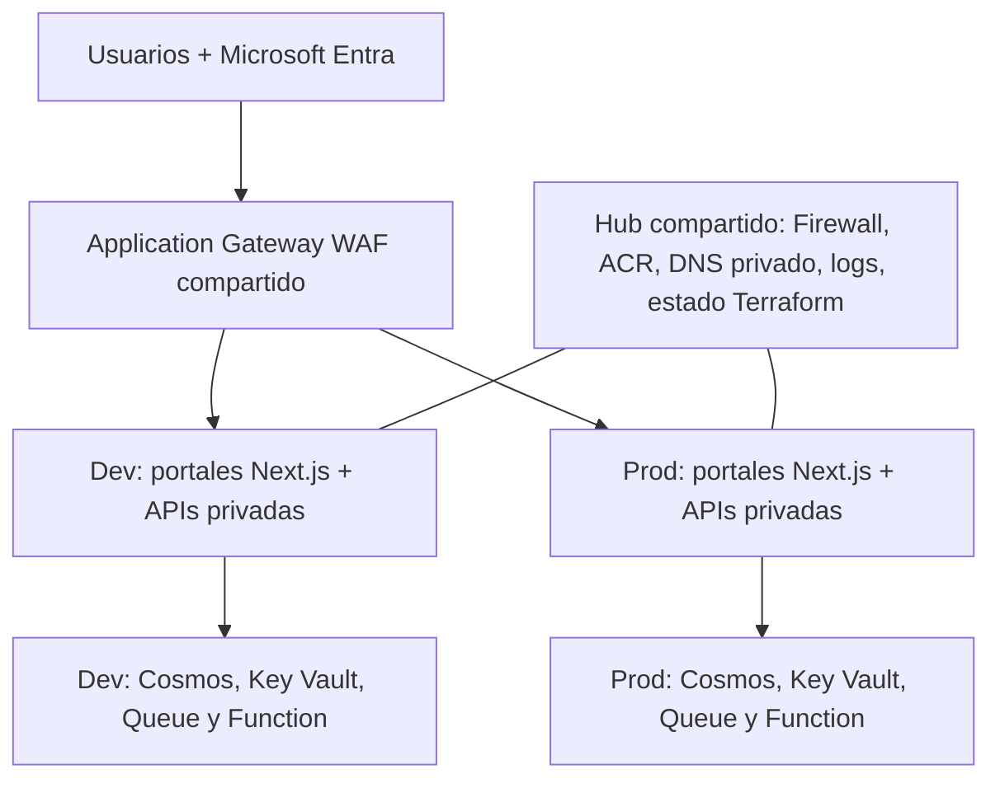

# Goliat - Nexus 1.0.0

[English](README.md) · **Español**

**Plataforma modular para aplicaciones en Azure.**

[Repositorio](https://github.com/danieljsaldana/goliat-nexus) · [Autor: Daniel J. Saldaña](https://danieljsaldana.dev/) · [Seguridad](SECURITY.md)

Nexus reúne infraestructura modular, configuración y una aplicación de ejemplo para iniciar tu proyecto en Azure. Comparte los servicios del hub entre Dev y Prod y adapta **Alba, el portal de solicitudes**, a tu producto: frontend Next.js estático, APIs Node.js con Cosmos DB compatible con MongoDB y procesamiento asíncrono con Azure Functions.

El hub comparte Application Gateway WAF_v2, Firewall Standard, ACR Premium, DNS privado, Log Analytics y backend. Cada entorno tiene su propia red, Container Apps, identidades, Cosmos y vaults. Webs y APIs se consumen por HTTPS a través del WAF. Los orígenes web Standard solo admiten su IP; gateway, APIs, Functions y datos permanecen privados. Se usa el hostname generado por Azure y un certificado público renovado desde la red privada; se puede configurar un dominio propio. Compartir evita duplicación de infraestructura, sin garantizar un importe de ahorro.

## Arquitectura



Alba registra solicitudes y procesa sus eventos; las aprobaciones o acciones de negocio se implementan en tu aplicación. Los eventos internos no pasan por el WAF público.

## Configuración legible

- [environments/common.tfvars](environments/common.tfvars): identidad, región, hub, estado y operación comunes.
- [environments/dev.tfvars](environments/dev.tfvars): componentes y capacidad de Dev.
- [environments/prod.tfvars](environments/prod.tfvars): componentes y capacidad de Prod.
- [examples/demo](examples/demo): otra instalación para evaluar el producto; nombre y estado diferentes.

El mapa `web_portals` define los portales de cada entorno. El ejemplo contiene `tenant` (usuario) y `admin` (operaciones). Son interfaces de demostración para sustituir o adaptar a tu producto; añadir una entrada al mapa no genera una nueva aplicación de negocio. Añadir otra clave crea otro Static Web App; no requiere un nuevo flag ni duplicar el módulo. Cada entrada selecciona `view = "tenant"` o `view = "admin"` para reutilizar una de las dos interfaces de ejemplo. `access` asigna usuarios/grupos de Entra; con operadores vacíos se utiliza el usuario o grupo de `operator_object_id`.

Todos los tfvars HCL incluyen comentarios y líneas en blanco. El CLI genera las entradas `.auto.tfvars.json` de Terraform dentro de `.lz/`; JSON no admite comentarios. Los ejemplos ficticios se validan con `--examples` y no se aceptan para un despliegue.

## Desplegar

El despliegue de identidad usa AzureAD 3.10.0 para crear registros de aplicación y asignaciones en Entra. Se necesitan permisos de directorio para administrar esas aplicaciones y sus asignaciones, además de los permisos Azure del producto. Las credenciales de aplicación no se crean: el frontend usa autorización con PKCE.

Requisitos: Terraform ≥1.9 y <2, Python, Azure CLI. Para publicar las apps: ejecutor Linux privado, Node.js ≥24, npm, Docker con Buildx y motor Linux; SWA CLI `npm install -g @azure/static-web-apps-cli@2.1.0`. Comprueba cuotas de Static Web Apps: el ejemplo completo crea dos Standard por entorno. El WAF compartido es un recurso facturable incluso sin tráfico.

```sh
az login
./lz configure --name miplatforma --operator-ip '<TU-IP-PUBLICA>/32' --alert-email '<TU-CORREO>' --output-dir .local/environments
./lz check --config .local/environments
./lz deploy --config .local/environments --stage foundation
./lz deploy --config .local/environments --stage platform
# Continúa desde un ejecutor conectado a la subred de administración y al DNS privado.
./lz deploy --config .local/environments --yes
./lz smoke-test --config .local/environments --environment dev
./lz verify-application --config .local/environments --environment dev
```

La preparación inicial de la red y del ejecutor puede hacerse por fases como arriba. Cuando el ejecutor ya tenga acceso privado, una llamada sin `--stage` coordina las cinco capas. El producto reserva la subred de administración. Conecta un ejecutor existente o despliega el [agente privado opcional](examples/agent/README.md), basado en `modules/virtual_machine`, antes de aplicar Dev/Prod. El agente se configura y registra por separado; no recibe roles Azure por defecto. El CLI publica las imágenes por digest, sincroniza secretos en Key Vault, aplica el workload y publica código de Functions y portales. Por defecto crea o reutiliza el SPN de la instalación para Azure, conserva la sesión del operador para Entra y revoca el certificado de esa ejecución al terminar, también ante un fallo. El SPN y sus permisos permanecen hasta el desmontaje completo. Puedes repetir la operación tras un fallo; los manifiestos completos de imágenes se conservan por entorno. `--reuse-images` reutiliza esos digests, pero vuelve a publicar Functions y webs.

`./lz configure --demo --name midemo ... --output-dir .local/demo` prepara una instalación de evaluación. `deploy_demo` etiqueta los portales como evaluación; no cambia a almacenamiento en memoria. Las piezas se controlan exclusivamente con `enable_*`.

## Documentación y validación

[Funcionamiento](docs/FUNCIONAMIENTO.md) · [Variables](docs/VARIABLES_Y_TFVARS.md) · [Secretos](docs/SECRETOS.md) · [Recursos](docs/RECURSOS_DEL_PRODUCTO.md) · [Módulos y agente](docs/CATALOGO_MODULOS.md) · [Seguridad](docs/SEGURIDAD.md) · [Operación](docs/OPERACION_Y_RECUPERACION.md).

```sh
make fmt check test validate
make inventory site-data site site-check
```

Esta versión incluye pruebas automatizadas con proveedores simulados. Sigue los [criterios de producción](docs/OPERACION_Y_RECUPERACION.md) para validar tu propia instalación. El ejemplo incluye Microsoft Entra, validación JWT en las APIs, roles Requester/Operator y aislamiento por propietario. La aceptación real en Azure, MFA/Conditional Access de la organización y los ensayos de restauración siguen siendo requisitos de producción.

No existe migración automática desde 0.3/PostgreSQL. Usa un nombre nuevo. El CLI rechaza un manifiesto de arquitectura anterior y bloquea `platform` si su estado contiene la base antigua. Cosmos y sus colecciones tienen `prevent_destroy`: eliminar datos requiere un procedimiento explícito revisado.

Las herramientas y dependencias verificadas para 1.0.0 figuran en [VERSIONES](docs/VERSIONES.md). No se aplica automáticamente una actualización de protocolo a cuentas MongoDB 4.2 existentes.

Consulta [entrada pública y dominios](docs/ENTRADA_PUBLICA.md) para las rutas, el certificado, los cinco estados y la separación de orígenes Dev/Prod. Los usuarios del portal no necesitan VPN. La publicación y administración siguen usando un ejecutor privado.

## Un SPN por instalación y cinco planes guardados

Desde un ejecutor Linux con conectividad y DNS privados, sesión de usuario `az login` y permisos de bootstrap de Azure/Entra:

```sh
./lz deploy --config .local/environments --yes
```

El comando coordina foundation → platform → Dev → Prod → edge. Genera un plan guardado por capa y aplica exactamente ese archivo, sin recalcular durante `apply`. Las dependencias requieren planificar cada capa después de disponer de los outputs de la anterior. Los cinco estados se mantienen separados.

El SPN de Azure pertenece a la instalación: se crea la primera vez, se reutiliza en los despliegues siguientes y se retira como paso final del desmontaje completo. Cada ejecución usa un certificado nuevo, limitado a cuatro horas, que se revoca al terminar junto con su caché local. El SPN y sus permisos permanecen. AzureAD conserva la sesión del operador; no se conceden permisos globales de Graph al SPN. En CI con OIDC/MI se selecciona `--identity existing`.

La cancelación espera el cierre de Terraform antes de revocar la credencial. Conserva el diario `.lz/identities/installation-<nombre>-<suffix>/run.json`: permite reutilizar la misma identidad y recuperar una credencial interrumpida con `cleanup-identity --credentials-only`. Tras el desmontaje revisado de toda la infraestructura, `cleanup-identity --run <diario>` elimina el SPN y sus permisos; bloquea esa retirada mientras exista alguno de los cinco grupos. Eliminar recursos desde el Portal no dispara una eliminación automática en Entra. [Operación y límites](docs/OPERACION_Y_RECUPERACION.md).


## Previsualizar la web del producto

```sh
make site-serve
```

La web bilingüe incluye vistas interactivas de arquitectura, recorridos animados, enlaces a la configuración comentada del repositorio y documentación técnica. Consulta [site/README.es.md](site/README.es.md). Ejecuta `make site` antes de abrir `/site/index.html` o `/site/index.htm` desde un servidor HTTP local: los HTML de los diagramas son artefactos generados.

Los README y las [páginas de wiki](docs/wiki/Home.md) están disponibles en español e inglés. Las guías operativas y las etiquetas de los diagramas se muestran actualmente en español.

## Pipelines

Consulta [CI, seguridad, releases en borrador y publicación manual de Pages](docs/CI_CD.md). Las acciones están fijadas por SHA, los permisos son mínimos, Terraform utiliza proveedores simulados y los artefactos se auditan. Preparar estos archivos no sube código.

## Preparar GitHub sin subir código

Consulta [compilación y metadatos de la web](site/README.es.md) y [controles de publicación](docs/CI_CD.md). `make publication-check` revisa fuentes e historial; `make prepare-github` genera una copia local de fuentes públicas con un historial Git nuevo, sin commit ni push. Los archivos locales, credenciales y estados quedan fuera del checkout público y de la web. La URL prevista de GitHub Pages es configurable y no activa el hosting automáticamente.

## Apoya el proyecto

Si Goliat - Nexus te resulta útil, puedes apoyar su desarrollo a través de [GitHub Sponsors](https://github.com/sponsors/danieljsaldana). La aportación es opcional. El repositorio utiliza el mismo `.github/FUNDING.yml` que Goliat Cloud Inventory: `github: [danieljsaldana]`.
