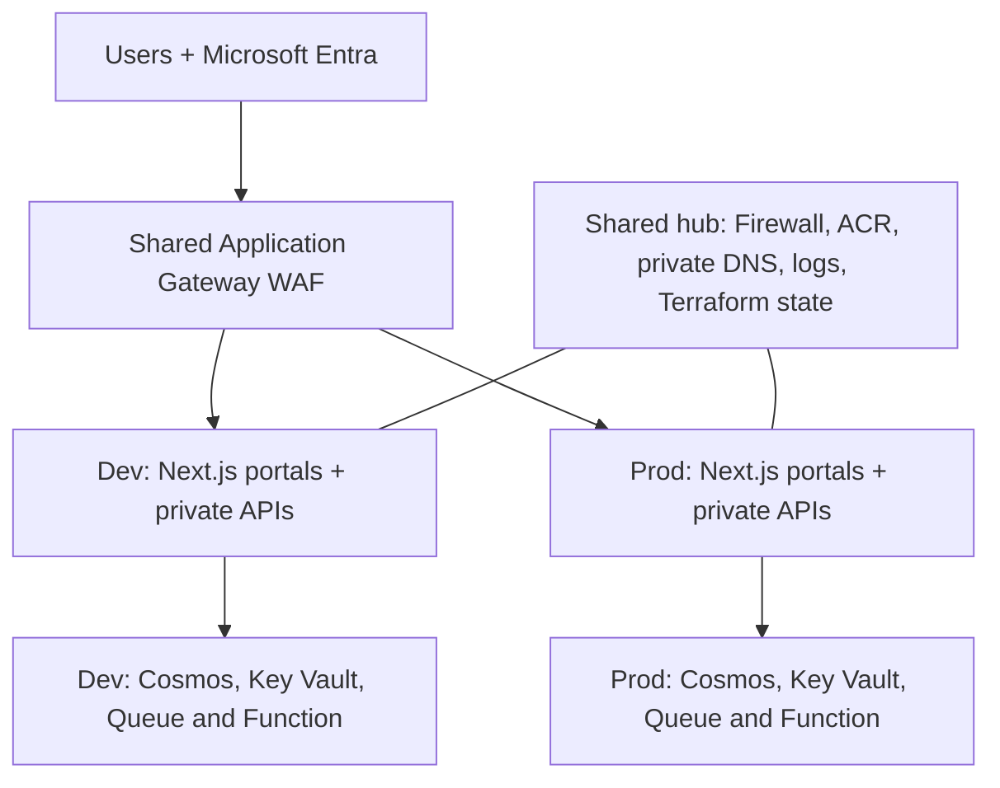

# Goliat - Nexus 1.0.0

**English** · [Español](README.es.md)

**A modular application platform for Azure.** Share the foundation, keep Dev and Prod separate, and learn the architecture through a working reference application.

[Source repository](https://github.com/danieljsaldana/goliat-nexus) · [Author: Daniel J. Saldaña](https://danieljsaldana.dev/) · [Security](SECURITY.md)

Nexus brings modular infrastructure, configuration and application code together to start your Azure project. Share hub services across Dev and Prod, adapt the included example to your product, and extend the platform as your requirements grow.

**Alba**, the included request portal, demonstrates a static Next.js frontend, Node.js APIs using MongoDB and Node.js Azure Functions. It registers requests and processes their events; implementing approvals or other business actions is up to your application.

## Architecture



The hub shares Application Gateway WAF_v2, Firewall Standard, ACR Premium, private DNS, Log Analytics and the state backend. Each environment owns its network, Container Apps, identities, Cosmos databases and vaults. Sharing avoids duplicating fixed infrastructure; it does not guarantee a particular saving.

Websites and APIs are reached through the WAF over HTTPS. Standard Static Web App origins accept only its IP; the gateway, APIs, Functions and data remain private. An Azure-generated hostname and a public certificate renewed from the private network are supported, with custom domains available through configuration. Internal events do not traverse the public WAF.

## Readable configuration

| File | Purpose |
| --- | --- |
| [environments/common.tfvars](environments/common.tfvars) | Shared identity, region, hub, state and operations |
| [environments/dev.tfvars](environments/dev.tfvars) | Dev components and capacity |
| [environments/prod.tfvars](environments/prod.tfvars) | Prod components and capacity |
| [examples/demo](examples/demo) | A separate evaluation installation, with its own name and state |

The `web_portals` map defines each environment's portals. The example includes `tenant` (users) and `admin` (operations). These are demonstration interfaces to replace or adapt for your own product; adding a map entry does not generate a new business application. Add another key to create another Static Web App, without adding a flag or duplicating the module. Each entry selects `view = "tenant"` or `view = "admin"` to reuse one of the two reference interfaces. `access` assigns Entra users/groups; an empty operators list uses the user or group in `operator_object_id`.

All HCL tfvars include comments and spacing. The CLI generates Terraform `.auto.tfvars.json` inputs inside `.lz/`; JSON cannot contain comments. Fictional examples can be validated with `--examples` and are rejected for deployment. Never put secrets in these files.

## Deploy

Requirements: Terraform ≥1.9 and <2, Python and Azure CLI. Publishing the application requires a private Linux executor, Node.js ≥24, npm, Docker with Buildx and a Linux engine, and SWA CLI (`npm install -g @azure/static-web-apps-cli@2.1.0`). Check Static Web Apps quotas: the complete example creates two Standard instances per environment. The shared WAF incurs costs even without traffic.

AzureAD 3.10.0 creates Entra application registrations and assignments. The operator needs directory permissions to manage those applications and assignments, as well as the Azure permissions required by the platform. No application passwords are created: the frontend uses authorization with PKCE.

```sh
az login
./lz configure --name myplatform --operator-ip '<YOUR-PUBLIC-IP>/32' --alert-email '<YOUR-EMAIL>' --output-dir .local/environments
./lz check --config .local/environments
./lz deploy --config .local/environments --stage foundation
./lz deploy --config .local/environments --stage platform
# Continue from an executor connected to the management subnet and private DNS.
./lz deploy --config .local/environments --yes
./lz smoke-test --config .local/environments --environment dev
./lz verify-application --config .local/environments --environment dev
```

Bootstrap the network and executor in stages as above. With private connectivity established, a call without `--stage` coordinates all five layers. The product reserves a management subnet. Connect an existing executor or deploy the [optional private agent](examples/agent/README.md), based on `modules/virtual_machine`, before applying Dev/Prod. Configure and register the agent separately; it receives no Azure roles by default.

The CLI publishes images by digest, synchronizes secrets into Key Vault, applies workloads, and publishes Functions and portals. By default, it creates or reuses the installation's Azure SPN, keeps the operator's Entra session, and revokes the execution certificate on completion or failure. The SPN and its roles remain until the complete teardown. You can rerun after failure; complete image manifests are retained per environment. `--reuse-images` reuses those digests but still republishes Functions and websites.

`./lz configure --demo --name mydemo ... --output-dir .local/demo` prepares an evaluation installation. `deploy_demo` labels portals as evaluation; it does not enable in-memory storage. Components are controlled by `enable_*` settings.

## One SPN per installation, five saved plans

From a private Linux executor with private DNS, an operator `az login` session and Azure/Entra bootstrap permissions:

```sh
./lz deploy --config .local/environments --yes
```

This coordinates **foundation → platform → Dev → Prod → edge**. Each layer produces a saved plan and applies that exact file. Dependencies require planning each layer after the preceding outputs exist. The five states remain separate.

The Azure SPN belongs to the installation: it is created on first use, reused on later deployments and removed as the final teardown step. Each run uses a new certificate, valid for at most four hours, revoked alongside its local cache when the run ends. AzureAD retains the operator's session; the SPN receives no global Graph permissions. CI using OIDC/managed identity selects `--identity existing`.

Cancellation waits for Terraform to stop before revoking its credential. Preserve `.lz/identities/installation-<name>-<suffix>/run.json`: it supports reusing the identity and recovering interrupted credentials with `cleanup-identity --credentials-only`. After reviewing and completing the infrastructure teardown, `cleanup-identity --run <journal>` removes the SPN and roles; it refuses while any of the five resource groups remain. Deleting resources in the Azure Portal does not automatically remove an Entra identity. See [operations and limits](docs/OPERACION_Y_RECUPERACION.md).

## Documentation and validation

The READMEs and the [wiki pages](docs/wiki/Home.md) are available in English and Spanish. Detailed operational guides and diagram labels currently use Spanish.

[Product guide](docs/FUNCIONAMIENTO.md) · [Variables](docs/VARIABLES_Y_TFVARS.md) · [Secrets](docs/SECRETOS.md) · [Resources](docs/RECURSOS_DEL_PRODUCTO.md) · [Modules and agent](docs/CATALOGO_MODULOS.md) · [Security](docs/SEGURIDAD.md) · [Operations](docs/OPERACION_Y_RECUPERACION.md)

```sh
make fmt check test validate
make inventory site-data site site-check
```

This release includes automated tests with mocked providers. Use the [production acceptance criteria](docs/OPERACION_Y_RECUPERACION.md) to validate your own installation. The example includes Microsoft Entra, API JWT validation, Requester/Operator roles and owner isolation. Acceptance testing in your Azure environment, corporate MFA/Conditional Access and recovery exercises remain production requirements.

There is no automatic migration from 0.3/PostgreSQL. Use a new installation name. The CLI rejects older architecture manifests and blocks `platform` when its state contains the old database. Cosmos and its collections use `prevent_destroy`: deleting data requires an explicitly reviewed procedure.

[VERSIONES](docs/VERSIONES.md) lists verified tools and dependencies for 1.0.0. Existing MongoDB 4.2 accounts are not automatically upgraded. See [public entry and domains](docs/ENTRADA_PUBLICA.md) for routes, certificates, the five states and Dev/Prod origin isolation. Portal users do not need a VPN; deployment and administration still use a private executor.

## Preview the product website

```sh
make site-serve
```

The bilingual website includes interactive architecture views, an animated request walkthrough, links to commented configuration source and technical documentation. See [site/README.md](site/README.md) for build and preview details. Generate it with `make site` before opening `/site/index.html` or `/site/index.htm` through a local HTTP server; diagram HTML files are build outputs.

## Contributing

Use the [issue forms](https://github.com/danieljsaldana/goliat-nexus/issues/new/choose) to report bugs, propose features, improve documentation or ask a usage question. Follow [Contributing](CONTRIBUTING.md) / [Cómo contribuir](CONTRIBUTING.es.md) to send changes from a fork through a checked pull request. English and Spanish are welcome.

## Licence

Nexus uses [PolyForm Noncommercial 1.0.0](LICENSE): noncommercial use, modification and sharing under its terms. Commercial use is not granted by this licence. See [licensing scope and third-party notices](LICENSING.md).

## Pipelines

See [CI, security, draft releases and manual Pages publishing](docs/CI_CD.en.md). Workflows use pinned actions, minimal permissions, mock Terraform providers and audited artifacts. Pull requests validate changes without deploying Azure.

## Publication safeguards

Read the [website build and metadata guide](site/README.md) and [publication controls](docs/CI_CD.en.md). `make publication-check` scans source candidates and Git history; `make prepare-github` can produce a separate public-source checkout without committing or pushing. Local configuration, credentials and states are excluded from the public checkout and website. The [product website](https://danieljsaldana.github.io/goliat-nexus/) is published through the manual Pages workflow.

## Support the project

If Goliat - Nexus helps you, you can support its development through [GitHub Sponsors](https://github.com/sponsors/danieljsaldana). Sponsorship is optional. The repository uses the same `.github/FUNDING.yml` as Goliat Cloud Inventory: `github: [danieljsaldana]`.
