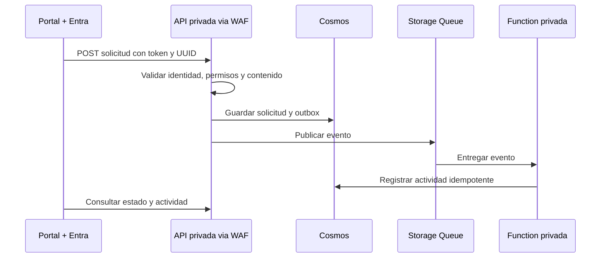

# Alba es una aplicación de ejemplo

[Inicio / Home](https://github.com/danieljsaldana/goliat-nexus/wiki/Home) · [English](https://github.com/danieljsaldana/goliat-nexus/wiki/Example-application)

Los portales tenant y admin solo sirven de referencia para desplegar y probar la base. Puedes sustituirlos por tu frontend y adaptar APIs y eventos a tu producto. No incluyen un sistema completo de tickets, aprobaciones o concesión automática de accesos.

| Pieza | Responsabilidad del ejemplo |
| --- | --- |
| Next.js estático | Formulario y consulta, inicio de sesión Entra con MSAL/PKCE. |
| APIs Node.js | Catálogo, solicitudes y actividades; validación JWT, rol y propietario. |
| Cosmos API MongoDB | Solicitudes y actividades por entorno. |
| Storage Queue | Transporte privado del evento. |
| Azure Functions | Consumidor de cola y timer de recuperación del outbox. |

## Identidad y permisos

Requester consulta sus propios registros; Operator consulta el entorno. La vista `admin` no concede permisos. Los asigna Entra y la API verifica el token en cada petición. Nunca se entrega la conexión Cosmos al frontend.

## Reintentos

El mismo UUID y contenido identifican la misma solicitud. Una respuesta 202 significa que el documento existe; no acredita que la Function haya terminado. Si falla la publicación, el outbox queda pendiente y el timer reintenta. La cola admite entregas repetidas; el consumidor evita duplicar la actividad por id. Tras cinco fallos de consumo se revisa la poison queue. La actividad y el estado no forman una transacción distribuida.

La simulación de la web de producto usa datos ficticios en el navegador y no se conecta con Azure. La instalación demo, en cambio, despliega recursos y persiste en Cosmos.
