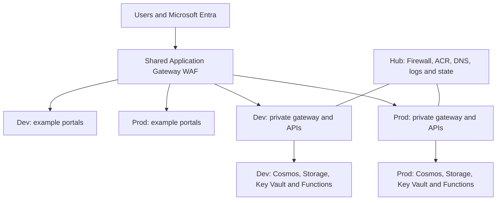

# Goliat Nexus architecture

[Inicio / Home](https://github.com/danieljsaldana/goliat-nexus/wiki/Home) · [Español](https://github.com/danieljsaldana/goliat-nexus/wiki/Arquitectura)

Goliat Nexus 1.0.0 is a modular foundation for Azure applications. A shared hub provides platform services; Dev and Prod own their applications, identities and data. Alba supplies two example portals, whose interfaces and business logic you adapt to your project.

## Shared and environment resources

| Scope | Components |
| --- | --- |
| Hub | WAF_v2, Standard Firewall, Premium ACR, private DNS, Log Analytics and state backend. |
| Dev / Prod | Spoke, internal Container Apps environment, Nginx gateway, Node.js APIs, Functions, Cosmos MongoDB, Storage, vaults and identities. |
| Example UI | Two Static Web Apps per environment: tenant and admin. Other products can replace these interfaces. |
| Optional | Private GitHub Actions VM, Event Grid and content storage. |

The browser downloads websites and calls APIs through the WAF over HTTPS. Static Web Apps origins admit only its IP; Nginx admits only its subnet. APIs validate identity and authorization on each request. Internal API → Cosmos/Queue → Function events remain private and do not traverse the WAF.

PaaS services are Azure-managed services: their Private Endpoints connect to the networks; this does not place the entire service inside a VNet. There is no direct Dev–Prod peering.

## States and costs

Deployment follows foundation → platform → dev → prod → edge. Five separate states each have a saved plan; dependencies require outputs from preceding layers.

Sharing avoids duplicating fixed services. WAF, Firewall and ACR still incur costs when Dev has no active replicas. Budget alerts do not cap spending. The full reference contains 345 Terraform objects, including permissions, rules and links; these are not 345 billable services.
