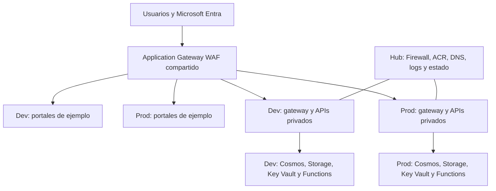

# Arquitectura de Goliat Nexus

[Inicio / Home](https://github.com/danieljsaldana/goliat-nexus/wiki/Home) · [English](https://github.com/danieljsaldana/goliat-nexus/wiki/Architecture)

Goliat Nexus 1.0.0 es una base modular para aplicaciones en Azure. El hub comparte servicios de plataforma y Dev/Prod mantienen sus aplicaciones, identidades y datos propios. Alba aporta dos portales de ejemplo; las interfaces y su lógica de negocio se adaptan a cada proyecto.

## Compartido y por entorno

| Ámbito | Componentes |
| --- | --- |
| Hub | WAF_v2, Firewall Standard, ACR Premium, DNS privado, Log Analytics y backend de estados. |
| Dev / Prod | Spoke, Container Apps interno, gateway Nginx, APIs Node.js, Functions, Cosmos MongoDB, Storage, vaults e identidades. |
| Ejemplo de interfaz | Dos publicaciones Static Web Apps por entorno: tenant y admin. No son pantallas obligatorias para otros productos. |
| Opcional | VM privada para GitHub Actions, Event Grid y almacenamiento de contenido. |

El navegador descarga las webs y llama a las APIs por HTTPS a través del WAF. Los orígenes Static Web Apps solo admiten la IP del WAF; Nginx solo su subred. Las APIs verifican identidad y permisos en cada petición. Los eventos API → Cosmos/Queue → Function son privados y no recorren el WAF.

Los servicios PaaS son servicios administrados de Azure: sus Private Endpoints se conectan a las redes, no significa que el servicio completo resida dentro de una VNet. Dev y Prod no tienen peering directo.

## Estados y costes

La secuencia es foundation → platform → dev → prod → edge. Hay cinco estados y un plan guardado por capa; las dependencias impiden planificar las capas sin sus outputs previos.

Compartir evita duplicar servicios de coste fijo. WAF, Firewall y ACR siguen generando coste aunque Dev no tenga réplicas activas. El presupuesto alerta y no limita el gasto. La referencia completa cuenta 345 objetos Terraform, incluidos permisos, reglas y vínculos; no son 345 servicios facturables.
