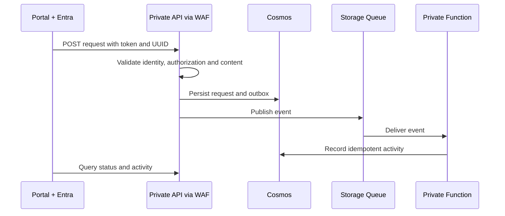

# Alba is an example application

[Inicio / Home](https://github.com/danieljsaldana/goliat-nexus/wiki/Home) · [Español](https://github.com/danieljsaldana/goliat-nexus/wiki/Aplicacion-de-ejemplo)

The tenant and admin portals demonstrate deployment and verification of the foundation. Replace them with your frontend and adapt APIs and events to your product. They do not implement a complete ticketing, approval or automatic access-granting system.

| Component | Example responsibility |
| --- | --- |
| Static Next.js | Forms and queries, Entra sign-in with MSAL/PKCE. |
| Node.js APIs | Catalogue, requests and activities; JWT, role and owner validation. |
| Cosmos MongoDB API | Separate requests and activities per environment. |
| Storage Queue | Private event transport. |
| Azure Functions | Queue consumer and outbox recovery timer. |

## Identity and authorization

Requester reads their own records; Operator reads the environment. The `admin` view grants no permissions. Entra assigns permissions and APIs check the token on each request. The frontend never receives the Cosmos connection.

## Retries

The same UUID and content identify the same request. A 202 response means the document exists; it does not establish that the Function has finished. Failed publication leaves a pending outbox record for timer retries. Queues may deliver duplicates; the consumer avoids duplicate activity by id. Review the poison queue after five failed processing attempts. Activity and status writes are not a distributed transaction.

The product website simulation uses fictional browser-local data and never connects to Azure. The deployed demo instead creates real resources and persists data in Cosmos.
